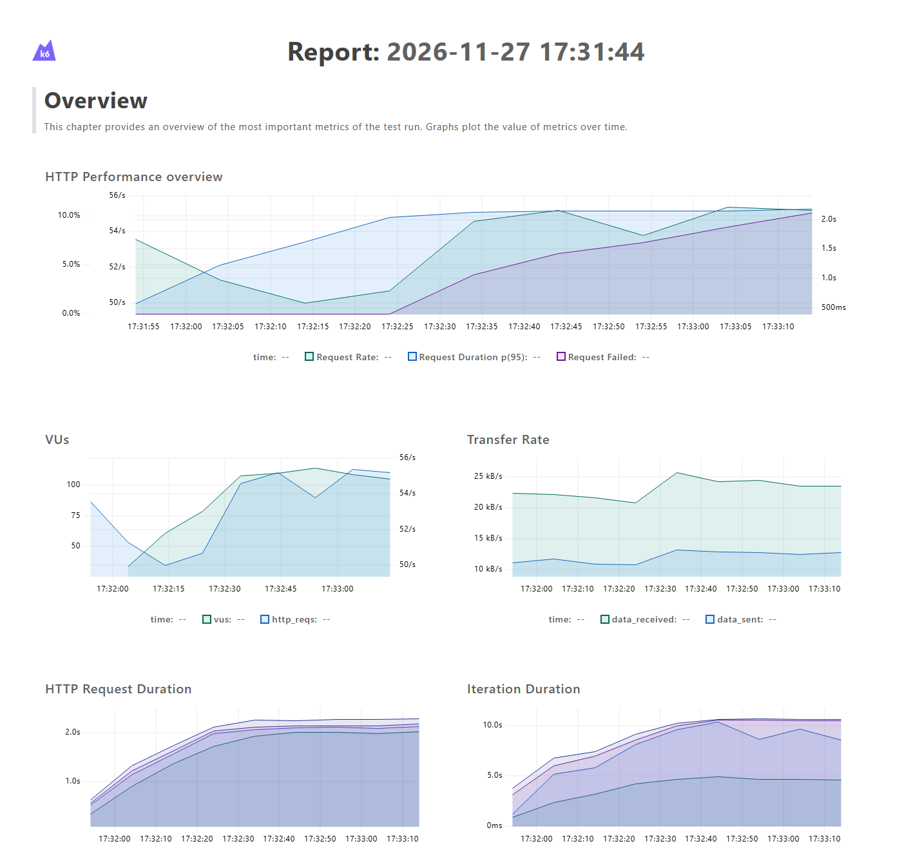

# 10 · Results and reports

> **Goal:** read the end-of-test summary, produce an HTML report with the built-in web dashboard, and save results for later analysis.

## The end-of-test summary

k6 v2 prints a compact summary by default (`--summary-mode=full` shows more, `--summary-mode=disabled` hides it):

```
  █ THRESHOLDS
    tx_claims_summary
    ✓ 'p(95)<3000' p(95)=345.04ms
    http_req_failed
    ✓ 'rate<0.01' rate=0.00%

  █ TOTAL RESULTS
    checks_succeeded...: 100.00% 175 out of 175
    http_req_duration..: avg=85.07ms min=10.13ms med=63.17ms p(90)=193.05ms p(95)=239.48ms ...
    http_req_failed....: 0.00% 0 out of 175
    http_reqs..........: 175  5.6/s
    iteration_duration.: avg=7.73s ...
    vus................: 5
```

| Metric | What it tells you |
|---|---|
| `http_req_duration` | Response time (from sending the request to the end of the response); read the percentiles |
| `http_req_failed` | Share of requests that failed (4xx/5xx unless marked as expected) |
| `http_reqs` | Request count and **rate** (throughput, requests per second) |
| `checks` | Share of your checks that passed |
| `iterations`, `iteration_duration` | Sessions completed and how long each took (includes think time) |
| `vus`, `vus_max` | Active VUs; for arrival-rate executors, how many k6 needed |
| `dropped_iterations` | Arrivals k6 couldn't start because no VU was free (open model) |
| `http_req_waiting` | Time to first byte: mostly server time |
| `http_req_connecting`, `http_req_tls_handshaking`, `http_req_blocked` | Network and connection set-up; high values point to network or connection limits |
| Your `tx_*` Trends | Each business transaction, like a JMeter Aggregate Report |

`--summary-trend-stats "avg,med,p(90),p(95),p(99),max"` (or `summaryTrendStats` in options) chooses which statistics to show.

## The web dashboard and an HTML report

k6 has a built-in web dashboard. Turn it on with an environment variable and export it as a single HTML file at the end:

```powershell
$env:K6_WEB_DASHBOARD="true"; $env:K6_WEB_DASHBOARD_EXPORT="results/report.html"
k6 run tests/09-claims-summary-workload.js
```

```bash
K6_WEB_DASHBOARD=true K6_WEB_DASHBOARD_EXPORT=results/report.html k6 run tests/09-claims-summary-workload.js
```

While the test runs, open <http://localhost:5665> to watch live charts. The exported `report.html` has charts over time for request rate, response time percentiles, failures and VUs, plus summary tables. It is the k6 counterpart of JMeter's HTML dashboard, and the CI workflow uploads it as an artifact.



The report has three parts: **Overview** (request rate, p95 and failures over time, VUs, transfer rate), **Timings** (each HTTP timing metric over time) and **Summary** (tables of trends, counters, rates and gauges, including your custom `tx_*` metrics).

We found that for a very short run (a couple of seconds) k6 skips the export with `The test run was short, report generation was skipped (not enough data)`. A 40-second run produced the report.

## Saving results

| Option | Gives you |
|---|---|
| `--summary-export results/summary.json` | The end-of-test summary as JSON (used by `scripts/step_load.py`) |
| `--out json=results/raw.json` | Every metric sample as JSON lines (large) |
| `--out csv=results/raw.csv` | Every sample as CSV (closest to a JMeter `.jtl`) |
| `handleSummary(data)` in the script | Full control: write your own text, JSON, HTML or JUnit XML at the end |

`handleSummary` example:

```javascript
export function handleSummary(data) {
  return {
    'results/summary.json': JSON.stringify(data, null, 2),
    stdout: `p95 = ${data.metrics.http_req_duration.values['p(95)']} ms\n`,
  };
}
```

Returning a value replaces the default summary on stdout unless you include `stdout`. jslib's `k6-summary` module has a `textSummary` helper that recreates the default text.

## Live outputs

For long tests, stream metrics to a time-series database and watch them in Grafana (Tutorial 13): `-o experimental-prometheus-rw` or `-o opentelemetry`. The InfluxDB output still works in v2 but prints a deprecation warning (planned for removal in v3).

**Next:** [11 · Scaling out](11-scaling-out.md)
