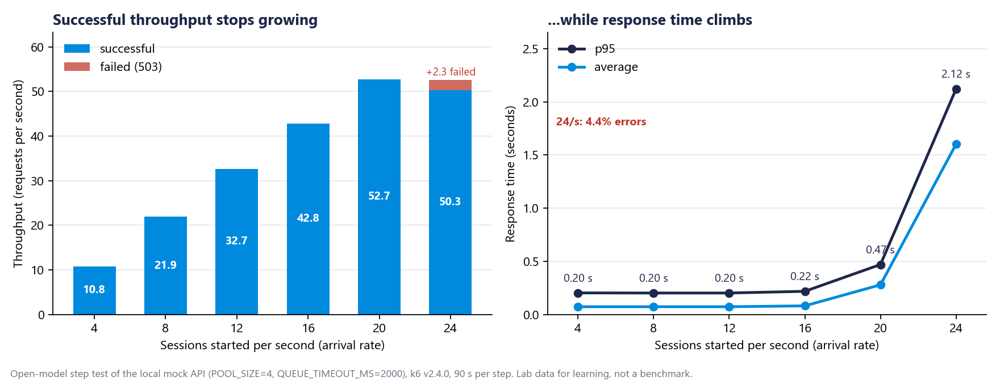
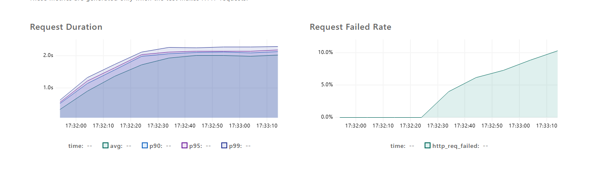

# 14 · Reading results and finding bottlenecks

> **Goal:** read k6 results with confidence, recognise the common patterns, and work through a real open-model stress test from data to a clear conclusion, then compare it with the closed-model JMeter results on the same system.
>
> **Tools:** the end-of-test summary, the web dashboard report, `scripts/step_load.py`, the mock's `/metrics` · **Data:** `results/sample/open-model-step-test/`

## A reading order that works

1. **Is the run valid?** The right script, profile and target? Did `vus`/`vus_max` and `iterations` match the plan? Any **`dropped_iterations`**? Was the load generator's CPU below about 80%?
2. **Thresholds.** Which passed and which failed (✓/✗, exit code 99)?
3. **Errors before speed.** `http_req_failed` and which statuses. Fast failures make response times look better.
4. **Percentiles against the SLO.** `tx_claims_summary` p95 and the other transactions.
5. **Throughput against the target.** `http_reqs` rate; for open models, compare the iterations rate with the configured `rate`.
6. **Over time** (web dashboard): stable, climbing, or getting worse the longer the test runs?
7. **Server side.** Pools, CPU, database, queues: the *why*.

## Common patterns

| What you see | What it usually means |
|---|---|
| Response time flat, throughput rises with load | Healthy: below capacity |
| **Throughput flattens while response time climbs** | **Saturation**: requests are queuing for a limited resource |
| Open model: errors appear and the failed rate **keeps rising during the test** | Arrivals exceed capacity, so the queue grows every second until requests time out |
| `dropped_iterations` > 0 | k6 couldn't start arrivals on time: the system is too slow, or `preAllocatedVUs`/`maxVUs` is too low |
| `vus_max` far above `preAllocatedVUs` | k6 had to add VUs because iterations got slower, an early warning of saturation |
| Errors are mostly 401/404 after one 5xx | Cascade errors from the script. Guard dependent steps |
| `http_req_waiting` ≈ `http_req_duration` | Time is spent on the server (or in its queue), not the network |
| High `http_req_connecting`/`blocked` | Connection limits or network problems, often on the load generator side |
| Slow creep over hours | A leak or build-up (soak test) |

## Worked example: an open-model step test

### Set-up

- **Script:** `09-claims-summary-workload.js` with `PROFILE=stress`: `constant-arrival-rate`, `RATE` new sessions per second for 90 s. Each session logs in and does **one** weighted action (dashboard 50%, report 35%, export 15%), with no think time. `preAllocatedVUs` 50, `maxVUs` 500.
- **System under test:** the mock API with `POOL_SIZE=4` and `QUEUE_TIMEOUT_MS=2000`: a small "database connection pool" that rejects requests after 2 s of waiting.
- **Steps:** 4, 8, 12, 16, 20 and 24 sessions per second: `python scripts/step_load.py --rates 4 8 12 16 20 24 --duration 90s --html-for-last`.
- **Machine:** one Windows laptop running both k6 v2.4.0 and the mock.

> These are **real measurements of the mock on a laptop**, used to learn to read results. They are not benchmarks of any real system. In an interview, quote your own project numbers, or say clearly that this was a lab exercise.

### Results (all requests)

| Sessions/s | Requests | Avg (ms) | p95 (ms) | p99 (ms) | Throughput (req/s) | Error % | Successful (req/s) | Claims p95 (ms) | Max VUs | Dropped | Server max queue | Server 503s | k6 exit |
|---:|---:|---:|---:|---:|---:|---:|---:|---:|---:|---:|---:|---:|---:|
| 4 | 987 | 73 | 203 | 298 | 10.8 | 0 | 10.8 | 281 | 50 | 0 | 0 | 0 | 0 |
| 8 | 2012 | 73 | 202 | 331 | 21.9 | 0 | 21.9 | 329 | 50 | 0 | 1 | 0 | 0 |
| 12 | 2982 | 73 | 202 | 329 | 32.7 | 0 | 32.7 | 330 | 50 | 0 | 2 | 0 | 0 |
| 16 | 3917 | 81 | 218 | 340 | 42.8 | 0 | 42.8 | 342 | 50 | 0 | 6 | 0 | 0 |
| 20 | 4868 | 279 | 470 | 572 | 52.7 | 0 | 52.7 | 575 | 50 | 0 | 24 | 0 | 0 |
| 24 | 4999 | 1602 | 2122 | 2245 | 52.6 | 4.36 | 50.3 | 2252 | 122 | 72 | 115 | 218 | **99** |

*Max VUs* is `vus_max` (50 were pre-allocated). *Server max queue* is the longest connection queue the mock has seen since it started; *Server 503s* is the 503s it sent in that step. Full JSON summaries per step are in `results/sample/open-model-step-test/`.

### Reading it

**1. Up to 16 sessions/s the system keeps up.** Throughput rises in step with the arrival rate (10.8 → 42.8 req/s) and p95 stays flat at about 0.2 s.

**2. At 20 sessions/s it is at its limit.** Throughput reaches 52.7 req/s with no errors, but p95 more than doubles (218 → 470 ms) and up to 24 requests are waiting for a connection. All thresholds still pass (Claims Summary p95 575 ms), but there is **no headroom**.

**3. At 24 sessions/s it fails, even though that's only 20% more load.** Throughput doesn't grow (52.6 req/s). p95 jumps to 2.1 s, 4.36% of requests fail with 503, k6 has to grow from 50 to 122 VUs, and **72 iterations are dropped**. Thresholds fail (`checks` and `http_req_failed`), and k6 exits with **99**.

**4. Client and server agree.** k6 counted 4.36% of 4,999 requests as failed: **218**. The mock sent exactly **218** 503s in that step. The guards in the script kept out cascade errors, so every failure is a real one.

**5. The failures get worse the longer the overload lasts.** In the web dashboard's *Request Failed Rate* chart (per reporting interval), failures start about 40 s into the step and climb steadily to about 10% by the end. With a fixed arrival rate, every second adds more work than the system can finish, so the queue keeps growing until requests hit the 2 s timeout.

**6. Capacity is about 52 requests per second for this mix.** That is 4 connections ÷ roughly 75 ms of "database" time per request. The average request took 73 ms at low load, when nothing was queuing.

### Same system, different tool and model: compare with JMeter

The companion JMeter repo ran a **closed-model** step test (10 → 160 users, with think time) against the same mock with the same pool settings:

| | JMeter, closed model | k6, open model |
|---|---|---|
| Throughput ceiling | about 43.5 req/s | about 52.7 req/s |
| First errors | at 160 users (4× the knee load) | at 24 sessions/s (20% over the limit) |
| How it degraded | Response time rose step by step; errors only once waits hit the timeout | Response time and errors grow *during* the step, because the queue is unbounded |
| With a 5 s timeout instead of 2 s | 0 errors even at 160 users | (not run) |

Why the ceilings differ: the **request mix** is different. The k6 stress profile does one action per session, so a bigger share of requests are cheap logins; the JMeter run did four actions per session, with more export polling and reports. Same pool, different average work per request, so a different req/s ceiling. **Capacity in req/s only means something for a given mix.** State it in business terms: "about 20 sessions per second with this mix".

Why the error patterns differ: in a closed model, users who wait stop sending, so the queue can never be longer than the number of users. In an open model the arrivals keep coming. Real public traffic behaves more like the open model, which is why it's the safer choice for stress tests. Neither result is wrong; you must say which model you used when you report.

### How to report it

> "Using an open-model stress test on the Claims Summary workload, the system handles up to about 20 sessions per second (about 52 requests per second) within the SLO, but with no headroom: p95 doubled at that point and requests were queuing for database connections. At 24 sessions per second, only 20% more, the connection pool was saturated: up to 115 requests waiting, p95 2.1 s, and 4.4% of requests failing with 503, rising to about 10% by the end of the step. Recommended: size for at least 20–30% headroom above expected peak, increase the pool if the database can take it, and reduce database time for the report query; then re-run the same steps."

## Exercises

1. Reproduce the table: start the mock with `POOL_SIZE=4` and `QUEUE_TIMEOUT_MS=2000` and run `python scripts/step_load.py --rates 4 8 12 16 20 24 --html-for-last`. Your numbers will differ a little; the shape should not.
2. Re-run the 20 and 24 steps with `POOL_SIZE=8`. Where is the new ceiling?
3. Run the closed `load` profile with `-e VUS=80 -e RAMP=30s -e DURATION=2m -e THINK_MIN=0.5 -e THINK_MAX=1.5` against the same mock and compare the error pattern with step 24.
4. Open `results/step-load/dashboard-rate-24.html` and find the moment the failed rate starts rising.

**Next:** [15 · JMeter vs k6, cheat sheet and interview Q&A](15-jmeter-vs-k6-cheat-sheet-interview-qa.md)
